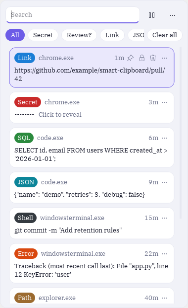

# Smart Clipboard

A local, privacy-focused clipboard manager for Windows. It remembers what you copy, labels each item (link, code, JSON, SQL, possible secret, ...), keeps everything **DPAPI-encrypted on your own machine**, and lets you search and paste from a Win+V-style window. Python, PySide6, SQLite, `pywin32`. **No network access.**

<p align="center">
  
  &nbsp;
  
</p>

<sub>Images are the real window rendered off-screen from made-up data (no real clipboard content). The demo plays as an animated PNG: type a search, filter to secrets, reveal a masked item.</sub>

> **Not a password manager.** Don't store real passwords in it. Its value is automatic sorting of everyday clipboard text, and handling anything that looks like a secret carefully.

## Why

Win+V keeps about 25 items, has no real search or labels, and loses history on restart. Ditto, CopyQ and others cover history well; this project doesn't claim to beat them. What it adds: labels that use the source app as a hint, secrets that are masked, kept for 2 hours, and removed from the clipboard and Win+V history, and an honest threat model.

## Highlights

- **Encrypted at rest:** one DPAPI-encrypted payload per row; only `id` and `created_at` are plaintext (a test inspects the raw file). Dedupe uses HMAC-SHA256 with a DPAPI-protected key, so short secrets can't be brute-forced from the database.
- **Event-based capture:** `AddClipboardFormatListener` on its own thread, a queue to the Qt thread, retry when the clipboard is busy, merging of repeated events, and own-write detection by clipboard owner.
- **Rule-based labels (12 types)** and **three-outcome secret detection** (normal / secret / "Review?"): known key formats, Luhn card check, entropy plus dictionary and character mix, source-app hint. Thresholds are in config.
- **Privacy controls:** pause, app exclusion list, and respect for the Windows opt-out clipboard formats. Safe paste-back of secrets: opt-out formats set, clipboard cleared after 30 s only if nothing newer was copied, entry removed from Win+V history.
- **UI:** frameless window at the pointer, filter chips, pinning, masked secrets that never match a search, 10-second reveal, paste into the previous app, light/dark following Windows, excluded from screen capture.
- **Hotkeys** through `RegisterHotKey` (no global keyboard hook that antivirus tools flag): `Ctrl+Alt+V` open, `Ctrl+Alt+P` pause, `Ctrl+Alt+S` mark secret, `Ctrl+Alt+F` force-save.
- **Never logs clipboard text:** logs hold IDs, types, lengths and counts only (tested).
- **No network:** a static import check plus a runtime audit-hook test, and a manual connection check (see below).

## By the numbers

| | |
|---|---|
| Code | about 6,600 lines of source, 7,200 lines of tests, 28 modules |
| Tests | 722 passing, all on fake data (12 opt-in real-clipboard tests, 17 known mislabels recorded as expected failures) |
| Dependencies | `pywin32`, `PySide6`, pinned `winrt-*` packages (Win+V cleanup); no network libraries |
| Status | Phase 1 built; a week of daily use under way (started 2026-11-19) |

## Design decisions worth a look

- **Own writes by clipboard owner, not sequence number:** closing the clipboard raises the sequence number unpredictably (measured), so the app ignores changes owned by its own window.
- **Three outcomes, tuned toward catching secrets:** a missed secret costs more than a false alarm. Unsure items are masked and expire like secrets until you decide.
- **Secrets stay out of search:** masked rows expose no text in any Qt role (tested), so nothing leaks into previews.
- **Honest limits over claims:** see the threat model; detection thresholds are starting values, not measured ones (Phase 2 measures them).

## Install and run

Windows 10/11 and Python 3.11+.

```powershell
python -m venv .venv
.\.venv\Scripts\python.exe -m pip install -e ".[dev,ui]"
.\.venv\Scripts\python.exe -m smartclip
```

Quit from the "..." menu (closing only hides the window). That menu also has **Start with Windows** (per-user startup entry, no admin) and **Start menu shortcut**. Run the tests with `.\.venv\Scripts\python.exe -m pytest -q`; a few opt-in tests touch the real clipboard and need `SMARTCLIP_REAL_CLIPBOARD_TESTS=1`.

**Using it:** click a card or press Enter to paste into the app you were using (only if it is back in front; otherwise it is copied and you press Ctrl+V). Type to search, click a badge or chip to filter, click the bullets (or `Ctrl+R`) to reveal a secret. Settings live in `src/smartclip/config.py` (retention 90 days / 2 hours, exclusion list, and so on); data lives in `%LOCALAPPDATA%\SmartClipboard\`, never in the repo.

## Threat model

| DPAPI protects against | DPAPI does not protect against |
|---|---|
| Someone copying the database file | Malware running under your Windows account |
| Another user account on the same PC | Anyone logged in as you |
| Casual snooping at the disk level | Someone who knows your Windows password |

- **Account-bound:** a profile reset or a move to another PC makes the data unreadable, with no recovery.
- **Metadata is visible:** item count and creation times.
- **Memory:** decrypted items live in Python memory and can't be reliably wiped; a revealed item is plain window text that accessibility tools can read.
- **The Windows opt-out flags are cooperative:** this app honors and sets them, but another clipboard tool may ignore them. Password managers are skipped only if they set those flags or you exclude them (the exclusion list starts empty).
- **Cloud clipboard sync:** whether removing a secret from Win+V reaches devices already synced is not verified.
- **Detection errs both ways:** hashes, IDs and file names look like passwords; passphrases of plain words are missed.

## No network

Two automated tests: app code imports no networking module, and the app's flows run under an audit hook that fails on any lookup or non-loopback socket (the only sockets are an internal `asyncio` loopback pair). A manual check on Windows 11 (two processes polled every second for 3 minutes while using the app) saw no connections. Code inside Qt, WinRT or Windows itself is outside what the tests can see, and 1-second polling misses sub-second connections.

## Roadmap

**Phase 2** trains small local models and compares them against these rules on a private test set (recall, false alarms, sample counts); whatever wins ships, and if the rules win the write-up says so. An opt-in, DPAPI-encrypted labeled-data log (`LABELED_LOG_ENABLED`, off by default, secrets stored only as same-shape random characters) collects that test set. No `.exe` packaging or tray icon yet.

## License

MIT. See [LICENSE](LICENSE).

The window uses IBM Plex Serif, bundled unchanged in `src/smartclip/ui/fonts/` under the SIL Open Font License 1.1 ([OFL.txt](src/smartclip/ui/fonts/OFL.txt)). It is loaded from disk; no font is fetched from the internet.
