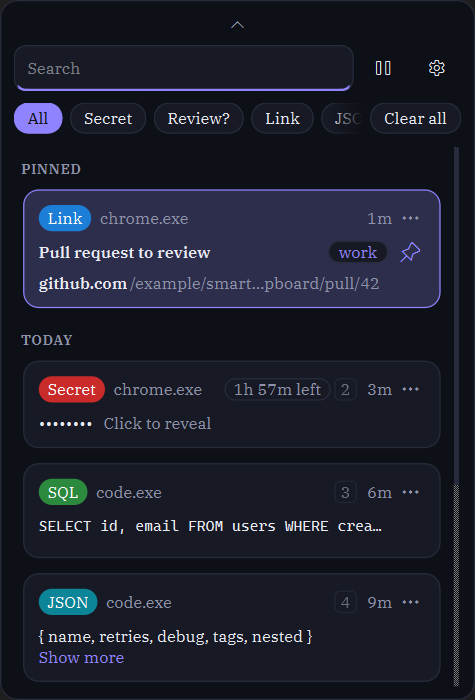

# Smart Clipboard

A local, privacy-focused clipboard manager for Windows. It remembers what you copy, labels each item (link, code, JSON, SQL, possible secret, ...), keeps everything **DPAPI-encrypted on your own machine**, and lets you search and paste from a Win+V-style window. Python, PySide6, SQLite, `pywin32`. **No network access.**

<p align="center">
  
  &nbsp;
  
</p>

<sub>Images are the real window rendered off-screen from made-up data (no real clipboard content). The demo plays as an animated PNG: type a search, filter to secrets, reveal a masked item, open a card's actions.</sub>

> **Not a password manager.** Don't store real passwords in it. Its value is automatic sorting of everyday clipboard text, and handling anything that looks like a secret carefully.

## Why

Win+V keeps about 25 items, has no search or labels, and loses history on restart. Ditto, CopyQ and others cover history well; this project doesn't claim to beat them. It adds source-aware labels, masked secrets that expire after 2 hours and are removed from the clipboard and Win+V history, and an honest threat model.

## Highlights

- **Encrypted at rest:** one DPAPI-encrypted payload per row; only `id` and `created_at` are plaintext (a test inspects the file). Dedupe uses a DPAPI-protected HMAC key, so short secrets can't be brute-forced from the database.
- **Capture and labels:** event-based listener on its own thread, 12 rule-based labels, three-outcome secret detection (normal / secret / "Review?") with thresholds in config.
- **Privacy controls:** pause, app exclusion list, respect for the Windows opt-out formats, safe paste-back of secrets (cleared after 30 s only if nothing newer was copied).
- **Window:** frameless, opens at the pointer or, if you choose "Where I left it" in settings, where you last dragged it by its top handle; day groups, filter chips, pinning with optional names and tags, previews by type (link domain, JSON keys, code, file name, error first line, colour swatch) with "Show more", a countdown on secrets, masked secrets that never match a search, paste into the previous app (`Alt+1` to `Alt+9` for the first nine), Undo for deletes and Clear all, a settings panel, light/dark following Windows, hidden from screen capture.
- **Tray icon**: shows the app is running (grey while capture is paused); click it to open the window, right-click for Open, Pause or Resume, and Quit.
- **Hotkeys** via `RegisterHotKey` (no global keyboard hook): `Ctrl+Alt+V` open, `Ctrl+Alt+P` pause, `Ctrl+Alt+S` mark secret, `Ctrl+Alt+F` force-save.
- **Never logs clipboard text** (tested) and **makes no network calls** (see below).

Source about 9,300 lines in 34 modules; 1,073 tests on fake data (12 opt-in real-clipboard tests, 17 known mislabels kept as expected failures). Dependencies: `pywin32`, `PySide6`, pinned `winrt-*` packages (Win+V cleanup). Status: Phase 1 built, a week of daily use under way.

## Install and run

Windows 10/11 and Python 3.11+.

```powershell
python -m venv .venv
.\.venv\Scripts\python.exe -m pip install -e ".[dev,ui]"
.\.venv\Scripts\python.exe -m smartclip
```

Click a card or press Enter to paste into the app you were using; type to search; click a badge or chip to filter; click the bullets (or `Ctrl+R`) to reveal a secret. Deleting and Clear all (pinned items are kept) act at once, with **Undo** for 5 seconds. The handle at the top of the window drops down the search, filters, pause and a **settings** gear (retention, font, where the window opens, Start with Windows, a list of every keyboard shortcut, Clear all and Quit; closing the window only hides it). Each card has Pin and a "..." button that slides in copy, paste, mark secret/normal and delete. Tests: `.\.venv\Scripts\python.exe -m pytest -q` (opt-in real-clipboard tests need `SMARTCLIP_REAL_CLIPBOARD_TESTS=1`). Data lives in `%LOCALAPPDATA%\SmartClipboard\`, never in the repo.

## Threat model

| DPAPI protects against | DPAPI does not protect against |
|---|---|
| Someone copying the database file | Malware running under your Windows account |
| Another user account on the same PC | Anyone logged in as you |
| Casual snooping at the disk level | Someone who knows your Windows password |

Also: data is **account-bound** (a profile reset or another PC can't read it); item count and times are visible; decrypted items sit in Python memory and a revealed item is readable by accessibility tools; the **Windows opt-out flags are cooperative** (another clipboard tool may ignore them, and password managers are skipped only if they set them or you exclude them); cloud-sync removal of secrets is unverified; detection errs both ways (hashes look like passwords, plain-word passphrases are missed).

## No network

Two automated tests (no networking imports; an audit hook over the app's flows allows only an internal loopback pair) and a manual 3-minute connection check on Windows 11 found no connections. Code inside Qt, WinRT or Windows is outside what the tests can see, and 1-second polling misses sub-second connections.

## License

MIT. See [LICENSE](LICENSE). The window uses IBM Plex Serif, bundled unchanged under the SIL Open Font License 1.1 ([OFL.txt](src/smartclip/ui/fonts/OFL.txt)); no font is fetched from the internet.
